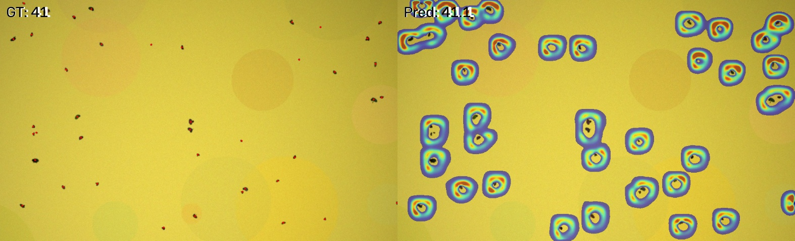

# PestCount · 农田害虫点监督计数与密度估计

<p align="center">
  
</p>

**只需点一下就算一只虫**——基于点监督密度估计的农田害虫自动计数系统。
输入诱捕板照片，输出害虫数量、密度热力图与逐板计数报告，并支持 ONNX INT8 端侧部署。

[](.github/workflows/ci.yml)


## 为什么是计数，而不是目标检测

诱捕板上的虫体密集、重叠、尺度小，检测范式（画框 → NMS）在重叠目标和遮挡处
会漏检，而且**框标注的成本是点标注的 5~10 倍**。密度估计范式直接回归
「每个位置的期望密度」，密度图积分即计数：

| | 检测（YOLO 系列） | 密度估计（本项目） |
|---|---|---|
| 标注成本 | 每只虫画框 | 每只虫点一下 |
| 重叠/遮挡 | NMS 抑制导致漏检 | 天然建模密度叠加 |
| 输出 | 框 + 置信度 | 计数 + 密度热力图 |
| 指标 | mAP / IoU | **MAE / RMSE**（计数误差） |

## 方法

```
图像 ──LiteCountNet(0.35M)──▶ 1/4 密度图 ──积分──▶ 计数
              ▲
   密度图 L1 + 局部计数一致性 + 全局计数约束
```

1. **几何自适应高斯核**：每个点的核宽 σ 取其 K 近邻平均距离的 β 倍。
   诱捕板存在透视（近大远小），固定 σ 会让密集区高斯过度叠加、稀疏区积分
   不守恒，造成随密度变化的系统性计数偏差。自适应核保证密度图积分严格等于
   真实点数（见 `pestcount/density.py` 与 `tests/test_core.py` 的守恒性测试）。

2. **局部计数一致性损失**：纯密度回归容易收敛到「峰值偏低、底盘变宽」的解
   ——密度图看着贴合，总数却系统性偏小。把预测与真值都划成 4×4 网格分别
   约束每格计数，等价于给网络加了积分守恒的硬监督
   （见 `pestcount/loss.py`）。

3. **合成 → 真实两阶段训练**：把单只害虫抠图后随机贴回真实板背景，自动获得
   精确点标注（`tools/make_synthetic.py`），用合成集预训练 + 少量真实点标注
   微调，把标注量压低一个量级。

4. **为端侧而生**：全 GroupNorm（小 batch 下比 BN 稳）、深度可分离卷积、
   0.35M 参数，导出 ONNX 后可 INT8 量化，附带基准脚本一键产出实测表
   （`benchmark.py`）。

## 结果

> 下表在 **程序化合成数据**（`tools/make_demo_assets.py` 生成的模拟素材）上
> 端到端跑通得到，仅用于验证管线正确性；真实诱捕板数据上的指标请在训练后
> 用 `evaluate.py` 实测替换。

<!--RESULTS_TABLE-->

### 计数精度（合成数据 sanity check，val 32 张，管线端到端验证）

| 指标 | 数值 | 说明 |
|---|---|---|
| MAE | **1.05** | 平均绝对计数误差（平均真值 27 只/板） |
| RMSE | 1.39 | |
| 计数准确率 | **95.8%** | 1 − \|pred−gt\|/gt |
| Bias | +0.02 | 无系统性高估/低估 |
| 参数量 | 0.33M | FP32 单文件 1.34 MB，INT8 **0.38 MB** |

### 部署基准（RTX 4060 Laptop / 1024×1024 / warmup 10 + 50 次实测）

| 版本 | 后端 | 体积(MB) | 延迟均值(ms) | 延迟P90(ms) | 显存(MB) |
|---|---|---|---|---|---|
| PyTorch FP32 | CUDA | 1.26 | **7.7** | 8.2 | 182 |
| ONNX FP32 | CPU | 1.27 | 93.5 | 97.7 | — |
| ONNX INT8 | CPU | **0.36** | 96.0 | 113.9 | — |

两点诚实说明：
* **INT8 在桌面 CPU 上未获得加速**：ONNX Runtime CPU EP 对 QDQ 卷积的融合
  依赖指令集支持，量化收益主要体现在边缘 ARM 平台（NNAPI / RKNN 通常
  2~4×）；桌面场景直接用 CUDA 版即可。INT8 的价值在这里体现在**体积
  缩小 3.7 倍**与量化后计数偏差仅 **0.19%**；
* 复现方式：`python benchmark.py --ckpt checkpoints/best.pt`，
  换机器数字会变，请以自己实测为准。

## 快速开始（无需任何数据，5 分钟跑通）

```bash
git clone https://github.com/zhao-si-yu/pestcount.git
cd pestcount
pip install -r requirements.txt

# 1. 生成模拟黄板背景与虫体贴图
python tools/make_demo_assets.py

# 2. 合成 160 张带精确点标注的样本
python tools/make_synthetic.py --num 160 --out-images data/images \
    --out-json data/annotations/all_synthetic.json

# 3. 分层划分 train / val
python tools/split_dataset.py --src data/annotations/all_synthetic.json \
    --out-dir data/annotations --ratios 0.8 0.2 0

# 4. 训练（RTX 4060 实测约 5 分钟，60 epoch）
python train.py --epochs 60 --batch 8 --crop 512

# 5. 评估 + 保存可视化三联图
python evaluate.py --ckpt checkpoints/best.pt --vis-dir docs/figures
```

## 用你自己的数据

```bash
# 1. 拍摄：诱捕板正面照，覆盖晴/阴/侧光，100~300 张
#    图片放入 data/images/boards/

# 2. 点标注（自带 tkinter 工具，左键加点/右键删点/滚轮缩放）
python tools/annotate.py --images data/images/boards --out data/annotations/all.json

# 3. 合成增强（可选，推荐）：单虫贴图放 assets/insects/
python tools/make_synthetic.py --num 600 --out-images data/images \
    --out-json data/annotations/synthetic.json

# 4. 两阶段训练：合成集预训练 → 真实集微调
python train.py --train-json data/annotations/synthetic.json --epochs 60
python train.py --train-json data/annotations/train.json --epochs 120 \
    --init-weights checkpoints/last.pt   # 从合成权重热启动
```

标注规范与 JSON 格式见 [`data/README.md`](data/README.md)。

## 公开数据集

时间紧、拍不到板子时，可以直接用公开数据集起步。`tools/download_datasets.py`
内置了清单（`--list`）、断点续传下载（`--get`）和解压（`--extract`）：

| 数据集 | 标注类型 | 规模 | 适配度 |
|---|---|---|---|
| **PST**（[Zenodo](https://zenodo.org/records/7801239)，CC BY 4.0） | **点标注** CSV | 144 MB，黄板白粉虱 | ★★★ 原生点标注，`--format pst-csv` 直接可用 |
| **Yellow Sticky Traps**（[GitHub](https://github.com/GEMIT-Institute-of-HS-Niederrhein/yellow-sticky-traps-dataset)） | VOC 框 | 284 张 / 8114 框，3 类 | ★★☆ 场景最贴近，需框转点 |
| Yellow Sticky Traps（[Kaggle](https://www.kaggle.com/datasets/friso1987/yellow-sticky-traps)） | VOC 框 | 808 MB，CC0 | ★★☆ 许可最宽松 |
| AgriPest（[论文](https://doi.org/10.3390/s21051601) / 原仓库已 404） | 框 | 49.7K 图 / 264.7K 框 | ★★★ 田间害虫语义最匹配，需自行找可用地址 |
| IP102（[GitHub](https://github.com/xpwu95/IP102)） | 分类 + 部分框 | 75K 图 / 102 类 | ★☆☆ 单虫特写，不适合计数 |

```bash
python tools/download_datasets.py --list                 # 看清单与许可
python tools/download_datasets.py --get pst              # 断点续传，可中断重跑
python tools/download_datasets.py --extract pst

# 公开数据集几乎都是「框」，用转换脚本变成「点」才能喂给本项目
python tools/convert_annotations.py --format pst-csv \
    --images data/raw/pest-sticky-traps/train \
    --ann data/raw/pest-sticky-traps/train/annotations.csv \
    --out data/images/pst --out-json data/annotations/pst.json

python tools/split_dataset.py --src data/annotations/pst.json \
    --out-dir data/annotations --ratios 0.8 0.2 0
```

> 网络提示：Zenodo / HuggingFace 在国内常不可达，GitHub 大文件直连约 200~300 KB/s，
> GB 级数据集建议挂夜间下载。若长期不可达，自采 100~200 张板照片（手机拍 + 本仓库
> 标注工具约 2 小时）往往比等下载更快，且数据是自己的，简历/论文里更好讲。

## 评估 / 导出 / 基准

```bash
python evaluate.py --ckpt checkpoints/best.pt            # MAE / RMSE / 可视化
python export_onnx.py --ckpt checkpoints/best.pt --int8  # ONNX + INT8 量化
python benchmark.py --ckpt checkpoints/best.pt           # 输出实测基准表
python tools/count_cli.py --ckpt checkpoints/best.pt --input 图片目录 --vis out/vis
python app.py                                            # GUI 演示（tkinter）
```

`benchmark.py` 会生成 Markdown 基准表（延迟均值/P90、体积、显存），
直接贴进 README 或论文即可。**端侧设备请在目标硬件上重跑**，不要用桌面数据代替。

## 项目结构

```
pestcount/
├── pestcount/           # 核心库
│   ├── density.py       # 几何自适应核 + 密度图生成（积分守恒）
│   ├── model.py         # LiteCountNet 轻量密度回归网络
│   ├── loss.py          # 密度 L1 + 局部计数一致性
│   ├── dataset.py       # 点标注数据集（JSON 格式）
│   ├── predictor.py     # 统一推理接口
│   ├── metrics.py       # MAE / RMSE / 计数准确率
│   └── utils.py         # 中文路径读写、热力图叠加
├── tools/
│   ├── annotate.py          # tkinter 点标注工具
│   ├── make_synthetic.py    # 合成数据生成（自动出点标注）
│   ├── make_demo_assets.py  # 无数据 demo 素材
│   ├── convert_annotations.py  # VOC/COCO/YOLO/PST-CSV -> 点标注
│   ├── download_datasets.py # 公开数据集清单与断点续传下载
│   ├── split_dataset.py     # 按密度分层的 train/val 划分
│   └── count_cli.py         # 无 GUI 批量计数
├── train.py / evaluate.py / export_onnx.py / benchmark.py / app.py
├── tests/test_core.py   # 核心逻辑自检（CI 覆盖）
└── data/README.md       # 标注格式与规范
```

## 已知局限（诚实版）

* 合成样本与真实照片仍有域差距（光照方向、景深、虫体粘连），**不能只用合成数据报指标**；
* 虫体被完全遮挡时密度估计也只能给出「期望值」，极端密集（粘连成片）时建议
  加大拍摄分辨率或分区域拍摄；
* 本仓库的合成指标仅验证管线，请以你自己数据上 `evaluate.py` 的实测为准。

## 引用

若本项目对你的工作有帮助，欢迎引用 / 点星：

```bibtex
@misc{pestcount2026,
  title  = {PestCount: Point-supervised Density Estimation for Field Pest Counting},
  author = {zhao-si-yu},
  year   = {2026},
  url    = {https://github.com/zhao-si-yu/pestcount}
}
```

## License

[MIT](LICENSE)
